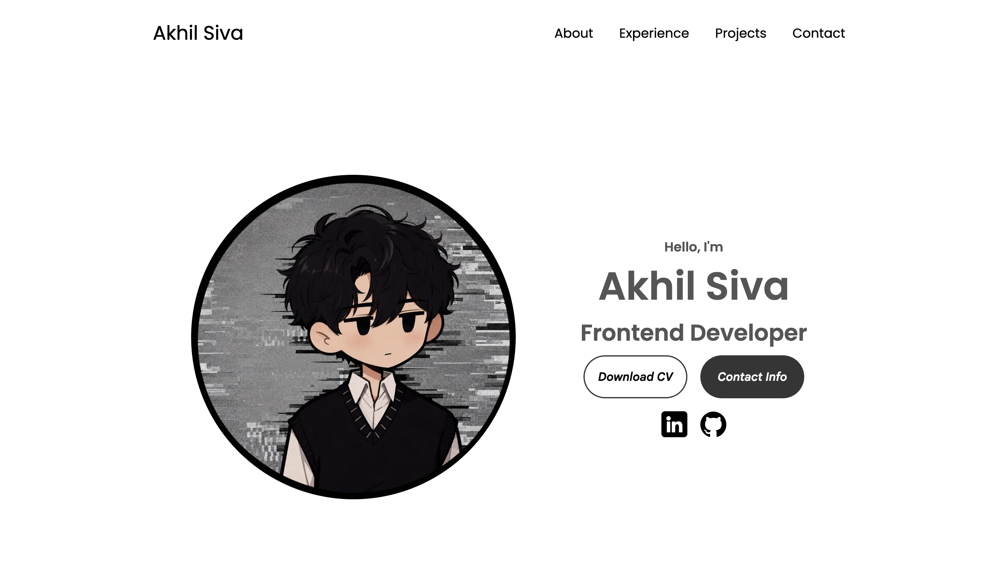
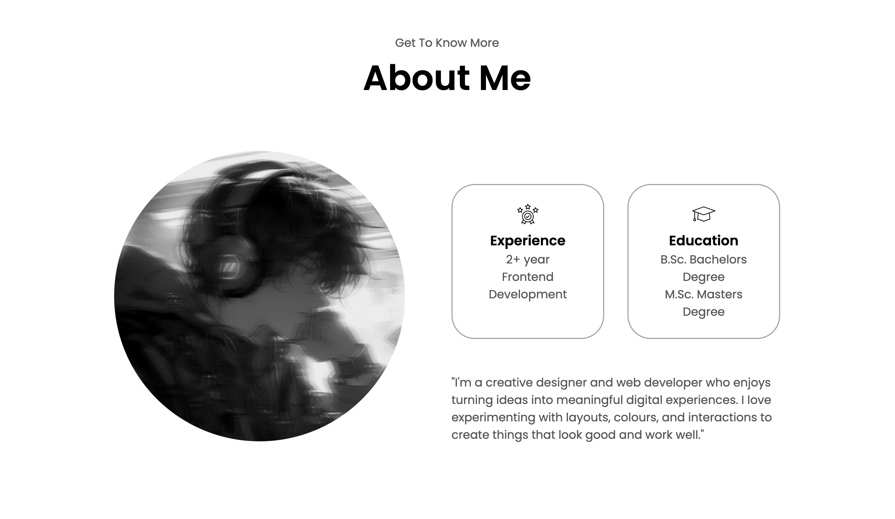
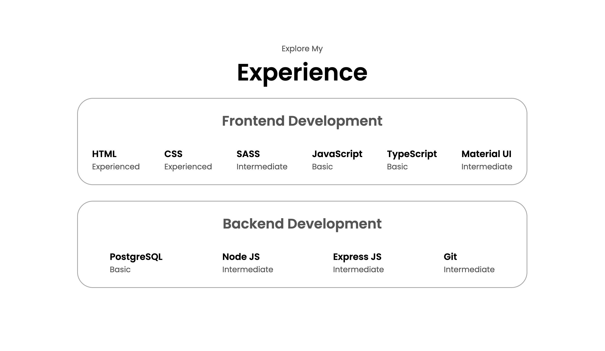
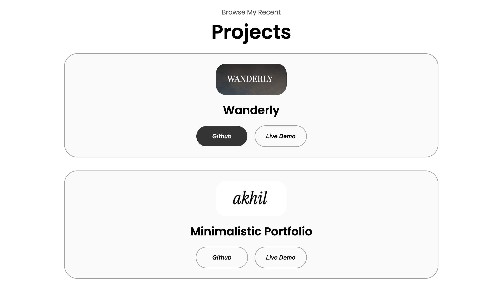
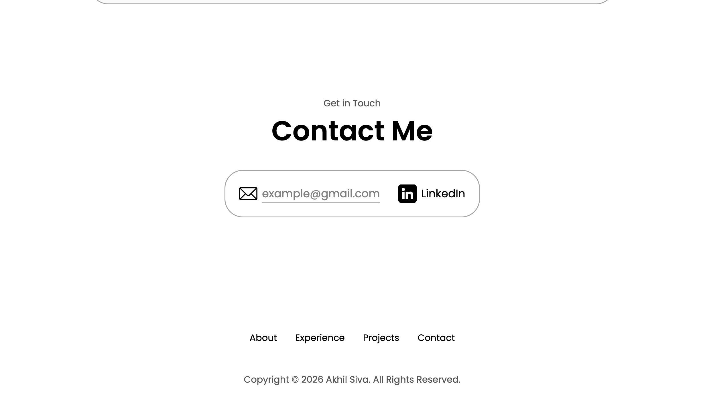

# Personal Portfolio

A minimalistic personal portfolio website to showcase my work, skills, and a little bit about me.I have showcased some of the projects that feels good to me. This is created with HTML, CSS, JavaScript.I wanted to make it clean and minimalistic where I could introduce myself, display my skills, and showcase some of my recent projects.

This website includes an Introduction Page, About Me Section, Experience Section and a contact Section.

## Preview

## Features

- Clean and minimal design
- Introduction section with Github and Linkedin icons.
- About me section
- Projects with GitHub Repository and Live Demo links.
- Contact section

## Built With

- HTML
- CSS
- JavaScript
- Google Fonts

## Note

- The Github Icon and Linkedin Icon will only take you that respective websites.I didnt connected it to my original socials.
- The Email that I used is just an example.Since it is a public repository I didnt displayed my original mail id.
- The CV I used is not mine.I just used a CV image I found online.

**Akhil Siva**

Thanks for checking out my project!
